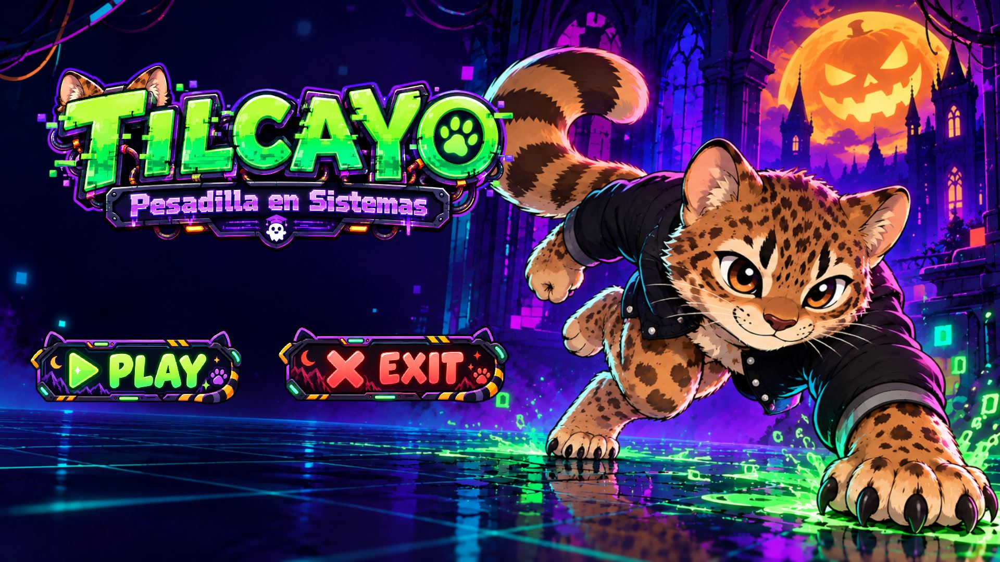
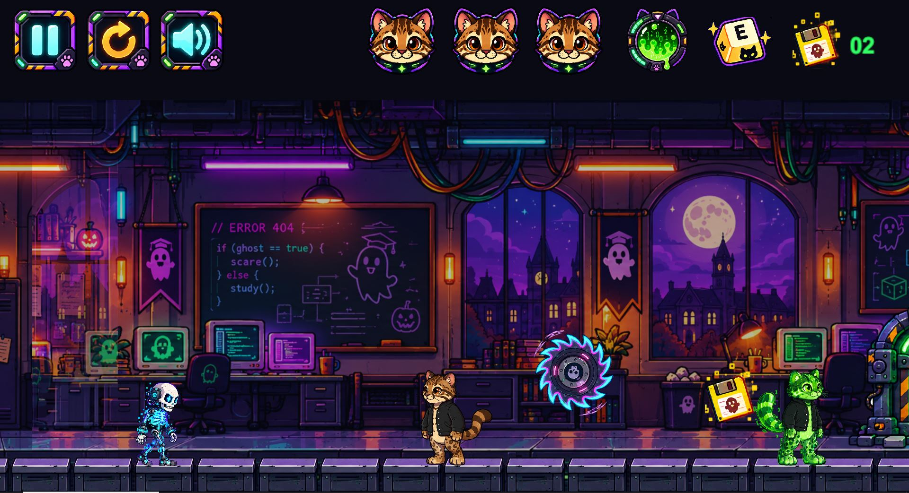
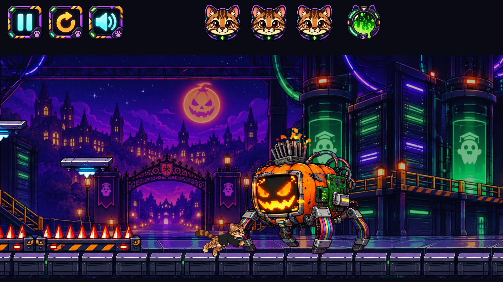
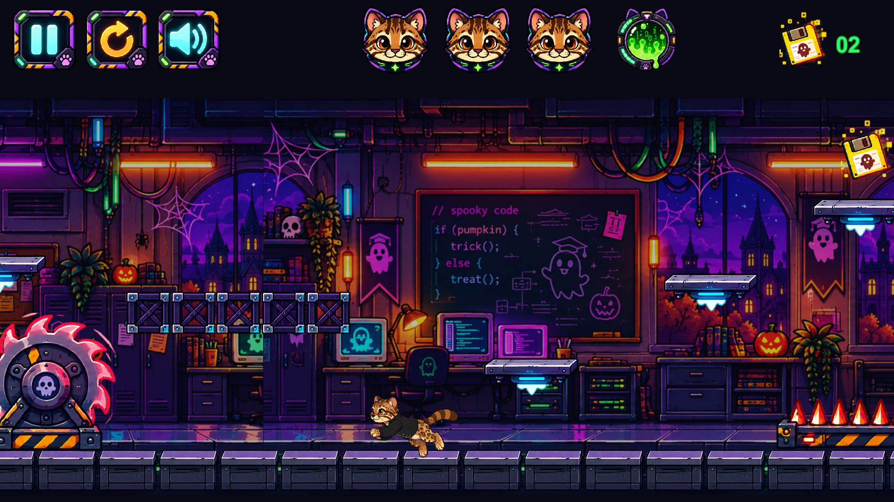
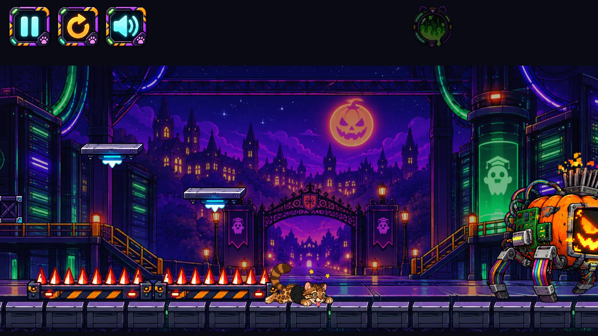
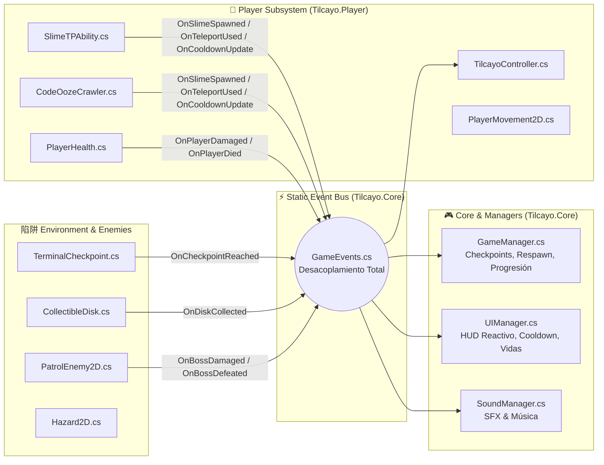

# 🐾 Tilcayo: Pesadilla en Sistemas — *2D Cyberpunk-Halloween Action Platformer*

-black?logo=unity)
-239120?logo=csharp)


> **Plataformero 2D de acción y precisión desarrollado en Unity 6**, protagonizado por **Tilcayo**, un felino cibernético atrapado en un servidor universitario infectado en noche de Halloween que utiliza una habilidad de **clonación y teletransporte de código líquido (`Slime TP`)** para atravesar trampas, recolectar disquetes y derrotar al jefe corrupto del sistema.

<p align="center">
  
</p>

<p align="center">
  
  
</p>

<p align="center">
  
  
</p>

---

## 📋 Ficha Técnica

| Atributo | Detalle |
| :--- | :--- |
| **Motor & Versión** | Unity 6 (`6000.6.4f1`) — Universal Render Pipeline (URP 2D) |
| **Lenguaje** | C# (Namespaces modulares: `Tilcayo.Core`, `Tilcayo.Player`, `Tilcayo.Environment`, `Tilcayo.Enemies`, `Tilcayo.Camera`, `Tilcayo.Editor`) |
| **Género** | 2D Action & Puzzle Platformer (Game Jam Project) |
| **Sistemas Destacados** | Mecánica de Teletransporte en 2 fases con Validación Física Anti-Stuck (`OverlapBox`), Arquitectura Desacoplada por Bus de Eventos (`GameEvents`), Pipeline de Automatización en `UnityEditor` |
| **Código Fuente Principal** | [`Assets/_Project/Scripts/`](Assets/_Project/Scripts/) |

---

## 🏗️ Arquitectura Desacoplada por Bus de Eventos (`GameEvents`)

Para mantener los subsistemas de Gameplay, UI, Audio y Progresión completamente independientes (evitando referencias cruzadas rígidas entre componentes), el proyecto implementa un **Event Bus estático centralizado** en [`GameEvents.cs`](Assets/_Project/Scripts/Core/GameEvents.cs).



---

## 🎯 Retos Técnicos y Sistemas Clave (Code Highlights)

### 1. Mecánica Insignia: Teletransporte en 2 Fases (`Slime TP`) y Validación Anti-Stuck
📄 **Código fuente:** [`SlimeTPAbility.cs`](Assets/_Project/Scripts/Player/SlimeTPAbility.cs) · [`CodeOozeCrawler.cs`](Assets/_Project/Scripts/Player/CodeOozeCrawler.cs)

La mecánica central del juego permite a Tilcayo expulsar una "baba de código viviente" que avanza horizontalmente ignorando trampas mortales (`sierras`, `pinchos`, `rejas`) y se materializa en un clon verde (`SlimeTilcayo`) hacia el cual el jugador puede teletransportarse al instante:
* **Matriz de Colisión por Layer Dedicada (`CloneSlime`):** [`CodeOozeCrawler.cs`](Assets/_Project/Scripts/Player/CodeOozeCrawler.cs) se asigna dinámicamente a la capa física `CloneSlime`, la cual colisiona con suelos y muros sólidos (`solidObstacleMask`) pero atraviesa los peligros (`Hazard2D`) y enemigos.
* **Control en 2 Pulsaciones (`Tecla E`):**
  1. **Pulsación 1:** Lanza el `CodeOozeCrawler`, que se desplaza hasta su distancia máxima (`6.0f` unidades) o hasta detectar una pared frontal con `Raycast`, reproduciendo su secuencia de asentamiento y estallido digital.
  2. **Pulsación Intermedia / 2:** Si el proyectil aún está viajando, una pulsación detiene su avance inmediatamente en la posición actual; una vez asentado como clon (`IsReadyForTeleport`), teletransporta al jugador.
* **Algoritmo Anti-Stuck (`OverlapBox` Safe Teleport):** Antes de mover el `Transform` del jugador al destino del clon, [`SlimeTPAbility.cs`](Assets/_Project/Scripts/Player/SlimeTPAbility.cs) evalúa `Physics2D.OverlapBox` con las dimensiones del collider del jugador (`playerBoundsCheck`) y prueba desplazamientos incrementales de seguridad para garantizar que Tilcayo **nunca quede incrustado dentro de geometría o techos bajos**.

<p align="center">
  
</p>

---

### 2. Arquitectura por Bus de Eventos (`GameEvents`) y Persistencia de Checkpoints
📄 **Código fuente:** [`GameEvents.cs`](Assets/_Project/Scripts/Core/GameEvents.cs) · [`GameManager.cs`](Assets/_Project/Scripts/Core/GameManager.cs) · [`UIManager.cs`](Assets/_Project/Scripts/Core/UIManager.cs)

* **Cero `Update()` innecesarios en UI:** [`UIManager.cs`](Assets/_Project/Scripts/Core/UIManager.cs) actualiza las caras de vida de Tilcayo, el medidor circular de enfriamiento de la habilidad (`OnCooldownUpdate(float percent)`), el contador de disquetes (`OnDiskCollected`) y la barra del jefe únicamente en respuesta a eventos de [`GameEvents.cs`](Assets/_Project/Scripts/Core/GameEvents.cs).
* **Gestión de Estado y Respawn con Feedback Visual (`Dazed State`):** [`GameManager.cs`](Assets/_Project/Scripts/Core/GameManager.cs) persiste entre cargas (`DontDestroyOnLoad`), restaura la contabilidad exacta de disquetes al reiniciar desde una terminal ([`TerminalCheckpoint.cs`](Assets/_Project/Scripts/Environment/TerminalCheckpoint.cs)) y activa el estado `ShouldRespawnDazed` para que Tilcayo reaparezca con una animación de aturdimiento temporal antes de retomar la acción.

---

### 3. Controlador de Personaje 2D y Optimización de `Animator`
📄 **Código fuente:** [`TilcayoController.cs`](Assets/_Project/Scripts/Player/TilcayoController.cs) · [`PlayerMovement2D.cs`](Assets/_Project/Scripts/Player/PlayerMovement2D.cs) · [`PlayerHealth.cs`](Assets/_Project/Scripts/Player/PlayerHealth.cs) · [`PlayerInputReader.cs`](Assets/_Project/Scripts/Player/PlayerInputReader.cs)

* **Separación de Responsabilidades (SRP):** El jugador no es un "God Script" monolítico, sino 4 componentes cohesivos forzados por `[RequireComponent(typeof(PlayerMovement2D), typeof(SlimeTPAbility), typeof(PlayerHealth))]`:
  * [`PlayerInputReader.cs`](Assets/_Project/Scripts/Player/PlayerInputReader.cs): Capa de abstracción de entrada compatible con teclado y mando.
  * [`PlayerMovement2D.cs`](Assets/_Project/Scripts/Player/PlayerMovement2D.cs): Física 2D de plataformeo, detección de suelo y bloqueo limpio de movimiento durante el casteo de habilidades o daño.
  * [`PlayerHealth.cs`](Assets/_Project/Scripts/Player/PlayerHealth.cs): Ventanas de invulnerabilidad (`i-frames`), parpadeo visual y transición al estado *Dazed* / muerte.
  * [`TilcayoController.cs`](Assets/_Project/Scripts/Player/TilcayoController.cs): Sincroniza el `Animator` usando exclusivamente identificadores precalculados con `Animator.StringToHash` (`SpeedHash`, `IsGroundedHash`, `VerticalVelocityHash`, `TriggerTeleportHash`) para evitar *allocations* de strings en cada frame.

---

### 4. Pipeline Integral de Automatización en `UnityEditor` (`ProjectSetupTools`)
📄 **Código fuente:** [`Assets/_Project/Scripts/Editor/ProjectSetupTools.cs`](Assets/_Project/Scripts/Editor/ProjectSetupTools.cs)

Para evitar errores manuales de configuración en el equipo durante la Game Jam, se desarrolló una herramienta de editor (`Tilcayo.Editor.ProjectSetupTools`) accesible desde el menú superior **`Tilcayo/*`**:
* Configura automáticamente **Layers**, **Sorting Layers** y la **Matriz de Colisiones 2D** de Unity.
* Automatiza el *slicing* de hojas de sprites (`SpriteImportMode`), genera los clips `.anim` y el grafo de estados del `AnimatorController`.
* Ensambla prefabs, construye el `HUD_Canvas` reactivo y configura la secuencia de **Cómic Introductorio** en `Scene_MainMenu`.

---

## 📂 Estructura del Código (`Assets/_Project/Scripts/`)

```text
Assets/_Project/Scripts/
├── Camera/
│   └── CameraFollow2D.cs          # Seguimiento suave 2D con amortiguación (SmoothDamp) y límites de nivel
├── Core/
│   ├── GameEvents.cs              # Bus de eventos estático para desacoplar Gameplay, UI y Audio
│   ├── GameManager.cs             # Singleton persistente: Checkpoints, Respawn, Pausa y Disquetes
│   ├── MainMenuController.cs      # Control del Menú Principal y transición de Cómic Introductorio
│   ├── SoundManager.cs            # Reproductor centralizado de música y efectos de sonido
│   └── UIManager.cs               # HUD reactivo suscrito a GameEvents (Vidas, Cooldown Slime TP, Boss HP)
├── Editor/
│   └── ProjectSetupTools.cs       # Herramienta UnityEditor para setup de layers, animaciones, HUD y escenas
├── Enemies/
│   └── PatrolEnemy2D.cs           # IA de patrullaje, detección de bordes/paredes y lógica del Jefe Final
├── Environment/
│   ├── CollectibleDisk.cs         # Disquetes coleccionables con feedback visual y emisión de evento
│   ├── Hazard2D.cs                # Sierras, pinchos y trampas ambientales
│   ├── LevelBoundaries2D.cs       # Límites de seguridad y kill-zones del escenario
│   ├── LevelGate.cs               # Puertas/portales de transición entre niveles
│   └── TerminalCheckpoint.cs      # Terminales de guardado de progreso y punto de reaparición
└── Player/
    ├── CodeOozeCrawler.cs         # Proyectil/Clon de código viviente en layer dedicada CloneSlime
    ├── PlayerHealth.cs            # Sistema de salud, i-frames y estado Dazed post-respawn
    ├── PlayerInputReader.cs       # Abstracción centralizada de inputs del jugador
    ├── PlayerMovement2D.cs        # Física 2D de movimiento horizontal, salto y detección de suelo
    ├── SlimeTPAbility.cs          # Habilidad de teletransporte en 2 fases con validación Anti-Stuck OverlapBox
    └── TilcayoController.cs       # Orquestador del jugador y sincronización optimizada con Animator
```

---

## 🎮 Controles

| Acción | Control |
| :--- | :--- |
| **Moverse a Izquierda / Derecha** | `A` / `D` o Flechas `←` / `→` |
| **Saltar** | `Espacio` o `W` o `Flecha Arriba` |
| **Habilidad Slime TP (Lanzar Clon / Teletransportarse)** | `E` (1ª pulsación: lanzar baba · 2ª pulsación: detener / teletransportar) |
| **Pausar Partida** | `Escape` o `P` |

---

## 🚀 Descarga Jugable & Cómo Abrir el Proyecto en Unity

* 🎮 **Build Jugable (Windows `.zip`):** Disponible en la sección [**Releases**](https://github.com/Gabosito1314/Tilcayo_GameJam/releases) de este repositorio.
* 📄 **Game Design Document (GDD):** Incluido en la raíz del repositorio ([`GDD_Tilcayo_Pesadilla_en_Sistemas.docx`](GDD_Tilcayo_Pesadilla_en_Sistemas.docx)).

### Abrir el Código Fuente en Unity 6
1. Clonar este repositorio:
   ```bash
   git clone https://github.com/Gabosito1314/Tilcayo_GameJam.git
   ```
2. Abrir **Unity Hub** y seleccionar `Add project from disk`.
3. Abrir con **Unity 6 (`6000.6.4f1` o superior compatible)**.
4. Cargar la escena `Assets/Scenes/Scene_MainMenu.unity` y presionar **Play**.

---

## 👨‍💻 Autor

**Gabriel Viscarra** ([@Gabosito1314](https://github.com/Gabosito1314)) — *Unity / C# Gameplay & Systems Programmer*
